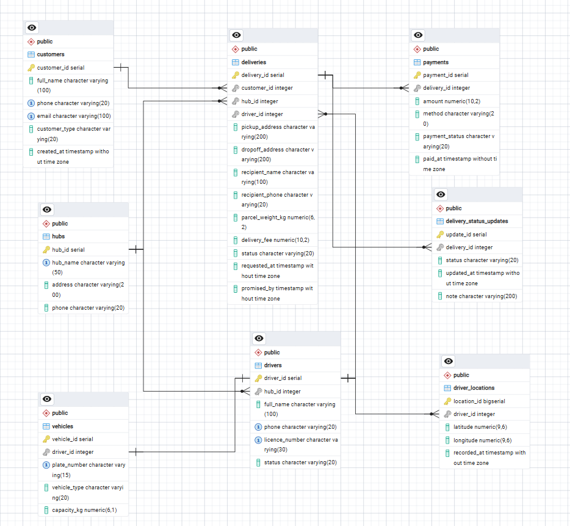
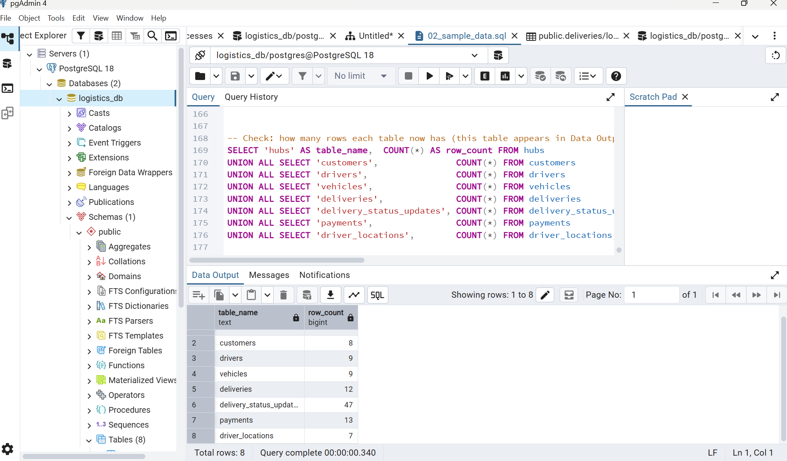

# Portfolio 1: Database Design and Modelling

**Case study:** LagosLink Deliveries (simulated), a parcel delivery company in Lagos with three hubs (Ikeja, Yaba and Lekki). The full case study statement is on the [repository front page](../README.md).

**Tools:** PostgreSQL 18, pgAdmin 4 (Query Tool and ERD Tool). **Database:** `logistics_db`.

All names, phone numbers, plates and addresses in this portfolio are made up.

## Files in this folder

| File | What it is |
|---|---|
| [`lagoslink_er_diagram.png`](lagoslink_er_diagram.png) | The ER diagram, generated by pgAdmin's ERD Tool from the real tables |
| [`01_create_tables.sql`](01_create_tables.sql) | Creates the 8 tables with their keys and constraints (the relational schema) |
| [`02_sample_data.sql`](02_sample_data.sql) | Fills every table with simulated LagosLink data |
| [`03_constraint_tests.sql`](03_constraint_tests.sql) | 8 tests that break the rules on purpose to prove the constraints work |
| [`screenshots/`](screenshots/) | 18 screenshots showing each step and each test result |

**How to rebuild it:** create an empty database in pgAdmin, open the Query Tool on it, and run `01`, then `02`. To repeat a test from `03`, highlight that one test and click Execute.

## 1. ER diagram

**How to read it:** a gold key is a primary key (PK) and a grey key is a foreign key (FK). A single bar marks the "one" side of a relationship and a crow's foot marks the "many" side. The crow's foot always touches the table that holds the foreign key.

| Relationship | Type | Foreign key |
|---|---|---|
| 1 hub has many drivers | One-to-many | `drivers.hub_id` |
| 1 hub handles many deliveries | One-to-many | `deliveries.hub_id` |
| 1 customer books many deliveries | One-to-many | `deliveries.customer_id` |
| 1 driver carries many deliveries (none until assigned) | One-to-many, optional | `deliveries.driver_id` |
| 1 driver uses 1 vehicle | One-to-one | `vehicles.driver_id` (UNIQUE) |
| 1 delivery has many status updates | One-to-many | `delivery_status_updates.delivery_id` |
| 1 delivery has many payment attempts | One-to-many | `payments.delivery_id` |
| 1 driver sends many GPS points | One-to-many | `driver_locations.driver_id` |

## 2. Relational schema

PK = primary key, FK = foreign key. Full definitions are in [`01_create_tables.sql`](01_create_tables.sql).

| Table | Columns | What one row holds |
|---|---|---|
| `hubs` | **hub_id** (PK), hub_name, address, phone | One hub |
| `customers` | **customer_id** (PK), full_name, phone, email, customer_type, created_at | One customer (business or individual) |
| `drivers` | **driver_id** (PK), *hub_id* (FK), full_name, phone, licence_number, status | One rider or van driver |
| `vehicles` | **vehicle_id** (PK), *driver_id* (FK), plate_number, vehicle_type, capacity_kg | One motorbike or van |
| `deliveries` | **delivery_id** (PK), *customer_id* (FK), *hub_id* (FK), *driver_id* (FK), pickup_address, dropoff_address, recipient_name, recipient_phone, parcel_weight_kg, delivery_fee, status, requested_at, promised_by | One delivery order |
| `delivery_status_updates` | **update_id** (PK), *delivery_id* (FK), status, updated_at, note | One change of stage, with its time |
| `payments` | **payment_id** (PK), *delivery_id* (FK), amount, method, payment_status, paid_at | One payment attempt |
| `driver_locations` | **location_id** (PK), *driver_id* (FK), latitude, longitude, recorded_at | One GPS point |

**Data types:** IDs are `SERIAL` (filled in automatically), or `BIGSERIAL` for `driver_locations`, which grows fastest. Foreign keys are `INT`. Text is `VARCHAR(n)`, and phone numbers are text because they start with 0. Money and weights are `NUMERIC`, which is exact, so totals add up correctly. Dates and times are `TIMESTAMP`.

## 3. Keys and constraints

The database contains 8 primary keys, 8 foreign keys, 7 unique constraints, 14 check constraints, plus NOT NULL on every required column.

| Constraint | What it enforces | Example in LagosLink |
|---|---|---|
| PRIMARY KEY | Every row has a unique, non-empty ID | `hub_id` in `hubs` |
| FOREIGN KEY | A link must point to a row that exists (referential integrity) | `deliveries.customer_id` must be a real customer |
| UNIQUE | No two rows share a value | Two drivers can't share a `licence_number`; one driver can't have two vehicles |
| NOT NULL | A required value can't be left empty | Every customer must have a `full_name` |
| CHECK | A value must pass a test | `status` must be one of 7 stages; `delivery_fee >= 0`; `promised_by > requested_at` |
| DEFAULT | A value is filled in when none is given | A new delivery starts as `'Requested'`; `created_at` is the current time |

## 4. Testing

### Sample data

[`02_sample_data.sql`](02_sample_data.sql) added 3 hubs, 8 customers, 9 drivers, 9 vehicles, 12 deliveries at different stages, 47 status updates, 13 payments (including a failed card payment that was then paid by transfer) and 7 GPS points.

### Constraint tests

Each test in [`03_constraint_tests.sql`](03_constraint_tests.sql) tries to store bad data. A red error means the rule worked. The rejected commands changed nothing, so the sample data stayed the same.

| # | Rule tested | What the test tried | Result | Evidence |
|---|---|---|---|---|
| 1 | Primary key | Add a second hub with ID 1 | Refused: `hubs_pkey` | [screenshot](screenshots/11_test1_primary_key.png) |
| 2 | Foreign key | Add a delivery for customer 999, who doesn't exist | Refused: `deliveries_customer_id_fkey` | [screenshot](screenshots/12_test2_foreign_key.png) |
| 3 | Foreign key (delete) | Delete customer 1, who still has deliveries | Refused: still referenced from `deliveries` | [screenshot](screenshots/13_test3_foreign_key_delete.png) |
| 4 | NOT NULL | Add a customer with no name | Refused: null value in `full_name` | [screenshot](screenshots/14_test4_not_null.png) |
| 5 | UNIQUE | Add a driver with an existing licence number | Refused: `drivers_licence_number_key` | [screenshot](screenshots/15_test5_unique.png) |
| 6 | One-to-one | Give driver 1 a second vehicle | Refused: `vehicles_driver_id_key` | [screenshot](screenshots/16_test6_one_to_one.png) |
| 7 | CHECK (list) | Set a delivery status to 'Lost' | Refused: `deliveries_status_check` | [screenshot](screenshots/17_test7_check_list.png) |
| 8 | CHECK (two columns) | Set a deadline before the booking time | Refused: `deliveries_check` | [screenshot](screenshots/18_test8_check_two_columns.png) |

**All 8 tests passed.**

## 5. Normalisation

If LagosLink kept everything in one spreadsheet, with one row per delivery, the same customer, hub and driver details would be typed again on every row, and lists (the status history, several payments) would be squeezed into single cells. That causes three problems:

- **Update problem:** if Ada Stores changes its phone number, every row must be fixed, and missing one leaves two different numbers.
- **Insert problem:** a new driver can't be recorded until they have done a delivery.
- **Delete problem:** deleting a customer's only delivery also loses the customer's details.

The design removes these problems by following the three normal forms:

- **First normal form (1NF):** every cell holds one value and every table has a primary key. The status history became `delivery_status_updates` (one row per stage, with its time), and payments became `payments` (one row per attempt).
- **Second normal form (2NF):** every column depends on the whole primary key. Every table has a single-column primary key, so no column can depend on only part of a key.
- **Third normal form (3NF):** no column depends on another non-key column. For example, a hub's address depends on the hub, not on the delivery, so it is stored once in `hubs` and a delivery only keeps `hub_id`. The same applies to customer, driver and vehicle details.

The design is therefore in **third normal form (3NF)**: each fact is stored once, and tables are linked by foreign keys instead of repeating data.

**One deliberate exception (controlled denormalisation):** `deliveries.status` repeats the latest stage from `delivery_status_updates`, so a customer's tracking page can show the current status without searching the whole history. The risk is that the two could disagree. Portfolio 3 handles this by updating both inside one transaction.

### The address describes the hub, not the delivery.
> ✏️ 

