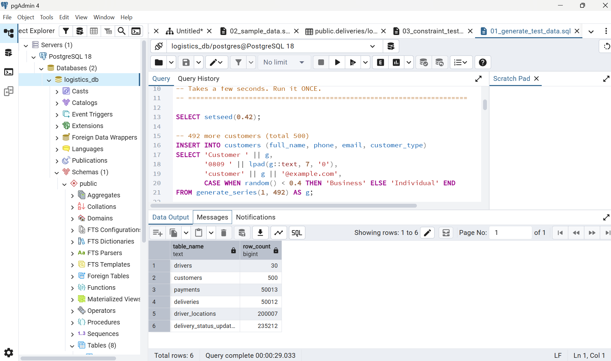

# Portfolio 2: Query Processing and Optimisation

**Case study:** LagosLink Deliveries (simulated), the same database as [Portfolio 1](../portfolio-1-database-design/README.md).

**Tools:** PostgreSQL 18 and pgAdmin 4 (Query Tool, `EXPLAIN ANALYZE`). **Database:** `logistics_db`.

## Files in this folder

| File | What it is |
|---|---|
| [`01_generate_test_data.sql`](01_generate_test_data.sql) | Adds a large volume of simulated data so performance differences are measurable |
| [`02_queries.sql`](02_queries.sql) | Three everyday LagosLink queries, each run with `EXPLAIN ANALYZE` |
| [`03_create_indexes.sql`](03_create_indexes.sql) | Creates one index for each query and lists the index sizes |
| [`screenshots/`](screenshots/) | Execution plans before and after indexing |

**How to repeat it:** after Portfolio 1's scripts, run `01` once, run each query in `02` (highlight one query, then Execute), run `03`, then run the queries in `02` again.

## 1. Test data

With only 12 deliveries every query finishes instantly, so an index makes no visible difference. [`01_generate_test_data.sql`](01_generate_test_data.sql) uses `generate_series` to add simulated rows. All constraints from Portfolio 1 still apply.

| Table | Rows |
|---|---|
| customers | 500 |
| drivers | 30 |
| deliveries | 50,012 |
| delivery_status_updates | 235,212 |
| payments | 50,013 |
| driver_locations | 200,007 |

## 2. How PostgreSQL processes a query

1. **Parse:** checks the SQL is valid and that the tables and columns exist.
2. **Plan (optimise):** the cost-based optimiser considers different ways to get the answer (for example, reading the whole table or using an index) and picks the cheapest. Its choice is the **execution plan**.
3. **Execute:** follows the plan and returns the rows.

`EXPLAIN ANALYZE` runs the query and shows the plan that was used, the rows read at each step, the pages read (`Buffers`) and the time taken. A **Seq Scan** reads every row of a table; an **Index Scan** uses an index to go straight to the matching rows.

## 3. The three queries

| Query | Business question | SQL (simplified) |
|---|---|---|
| Q1 | A customer tracks a parcel: its full status history | `WHERE delivery_id = 30000 ORDER BY updated_at` on `delivery_status_updates` |
| Q2 | Customer service opens a customer's history, newest first | `WHERE customer_id = 250 ORDER BY requested_at DESC` on `deliveries` |
| Q3 | The live map shows where a driver is now | `WHERE driver_id = 7 ORDER BY recorded_at DESC LIMIT 1` on `driver_locations` |

These run thousands of times a day in a delivery business, so their speed matters.

## 4. Results before indexing

| Query | Plan | Rows read to find the answer | Pages read | Execution time |
|---|---|---|---|---|
| Q1 | Parallel Seq Scan, then Sort | ~235,000 to find 5 | 1,728 | **76.484 ms** |
| Q2 | Seq Scan, then Sort | 50,012 to find 94 | 964 | **3.461 ms** |
| Q3 | Parallel Seq Scan, then top-N Sort | ~200,000 to find 1 | 1,667 | **63.151 ms** |

Evidence: [Q1 plan](screenshots/02_q1_before_seq_scan.png), [Q1 time](screenshots/03_q1_before_time.png), [Q2](screenshots/04_q2_before.png), [Q3](screenshots/05_q3_before.png).

In every case the database read the whole table and threw almost all of it away (`Rows Removed by Filter`).

## 5. Indexes created

| Index | Columns | Size | Why |
|---|---|---|---|
| `idx_status_updates_delivery_time` | `delivery_status_updates (delivery_id, updated_at)` | 7.3 MB | Finds one delivery's history, already in time order |
| `idx_deliveries_customer_requested` | `deliveries (customer_id, requested_at DESC)` | 1.5 MB | Finds one customer's deliveries, newest first |
| `idx_driver_locations_driver_time` | `driver_locations (driver_id, recorded_at DESC)` | 6.2 MB | Finds a driver's latest GPS point first |

All three are **composite indexes**: the first column serves the `WHERE` and the second serves the `ORDER BY`. All three first columns are **foreign keys**: PostgreSQL automatically indexes primary keys and `UNIQUE` columns, but not foreign keys, so these columns had no index until now. The indexes took 3.6 seconds to build. ([screenshot](screenshots/06_indexes_created.png))

## 6. Results after indexing

| Query | Plan after | Pages read | Before | After | Speed-up |
|---|---|---|---|---|---|
| Q1 | Index Scan using `idx_status_updates_delivery_time` | 4 | 76.484 ms | **0.232 ms** | **330×** |
| Q2 | Bitmap Index Scan on `idx_deliveries_customer_requested`, then Sort | — | 3.461 ms | **0.223 ms** | **15×** |
| Q3 | Limit → Index Scan using `idx_driver_locations_driver_time` | 4 | 63.151 ms | **0.031 ms** | **2,037×** |

Evidence: [Q1](screenshots/07_q1_after.png), [Q2](screenshots/08_q2_after.png), [Q3](screenshots/09_q3_after.png).

## 7. Performance analysis

- **All three queries switched from a sequential scan to an index**, and the `Rows Removed by Filter` lines disappeared: the database no longer reads rows only to discard them.
- **Q3 improved the most (2,037×).** Because the index stores each driver's points newest first, the plan reads the first index entry and stops (`Limit`). It reads 4 pages instead of 1,667 and no longer sorts about 6,700 rows.
- **Q1 improved 330×.** The index goes straight to the 5 rows for delivery 30000, and because they are stored in time order, the Sort step is no longer needed.
- **Q2 improved the least (15×).** The `deliveries` table is the smallest, so the original scan was already quick (3.5 ms). For 94 matching rows spread across the table, the optimiser chose a **Bitmap Index Scan**: it uses the index to list the pages that hold customer 250's rows, reads only those pages, then sorts the 94 rows.
- **Pattern:** the gain grows with the size of the table and shrinks with the number of rows the query needs. A query that needs 1 row out of 200,000 benefits far more than one that needs 94 out of 50,000.

**Costs and trade-offs:**

- The three indexes use about **15 MB** of disk and took 3.6 seconds to build.
- Every `INSERT` into these tables must also update the index, so writes become slightly slower. This matters most for `driver_locations`, which receives a GPS point from every active driver every few seconds. For LagosLink, fast live tracking is worth that cost, but indexes should only be added for queries that are actually used.

**Limitations of this test:**

- Each time is from a single run on a laptop, and times vary slightly between runs. A more reliable test would run each query several times and average the results.
- `read=` in the Buffers line means a page came from disk rather than memory on that run, which also affects timing.
- Planning time for Q1 rose from 0.8 ms to 2.2 ms, because the optimiser had more options to consider. It is still small compared with the execution time saved.
